# NETWORKWALKS-B084-WK3-PASSWORD-CRACKING

**Project:** Password Cracking with John the Ripper and Networkwalks Tools
**Internship Batch:** B084
**Intern:** Arban Iqbal Khan
**Week:** 03

## Project Overview

This project was completed as part of Week 3 of the Networkwalks Cybersecurity Internship.

The practical work involved recovering the password of a password-protected PDF provided by Networkwalks using two different approaches.

- **Project Module 1:** John the Ripper (JTR) and Johnny GUI.
- **Project Module 2:** Networkwalks Hash Calculator and Password Cracker.

Both approaches successfully recovered the same password. I then confirmed that the recovered password opened the protected PDF.

## Objectives

- Understand PDF password hash extraction.
- Learn how John the Ripper works.
- Configure and operate Johnny GUI.
- Extract PDF hashes using online tools.
- Perform password recovery using two different methods.
- Understand the importance of strong passwords and file protection.

## Tools and Technologies Used

| Tool                               | Purpose                                 |
| ---------------------------------- | --------------------------------------- |
| Windows 10                         | Operating environment                   |
| John the Ripper                    | Password recovery                       |
| Johnny GUI                         | Graphical interface for John the Ripper |
| OnlineHashCrack PDF Hash Extractor | PDF hash extraction                     |
| Networkwalks Hash Calculator       | PDF hash extraction                     |
| Networkwalks Password Cracker      | Password recovery                       |
| Notepad                            | Saving the extracted hash               |
| PDF Viewer                         | Verifying the recovered password        |

## Project Module 1: Password Cracking with JTR

### Step 1: Download and extract John the Ripper

Downloaded John the Ripper from the official Openwall source and extracted its archive.

### Step 2: Install Johnny GUI

Downloaded and installed Johnny, the graphical interface for John the Ripper.

### Step 3: Configure Johnny

Opened Johnny settings and selected the `john.exe` executable from the extracted John the Ripper `run` directory.

### Step 4: Extract the PDF hash

Uploaded the Networkwalks-provided protected PDF to the OnlineHashCrack PDF Hash Extractor.

The extracted hash used the `$pdf$` format.

### Step 5: Create the hash file

Copied the extracted hash into Notepad and saved it as `hash1.txt`.

### Step 6: Load the hash into Johnny

Opened `hash1.txt` using Johnny's Open Password File option.

### Step 7: Start the attack

Selected Start New Attack and allowed John the Ripper to process the PDF hash.

### Step 8: Recover the password

John the Ripper successfully recovered the PDF password.

### Step 9: Verify the result

Entered the recovered password into the protected PDF and confirmed that the document opened successfully.

## Project Module 2: Password Cracking with Networkwalks Tools

### Step 1: Open Networkwalks Hash Calculator

Visited:

[https://networkwalks.com/hash-calculator/](https://networkwalks.com/hash-calculator/)

### Step 2: Upload the protected PDF

Uploaded the same Networkwalks-provided PDF to extract its password hash.

### Step 3: Copy the extracted hash

Copied the complete hash generated by the Hash Calculator.

### Step 4: Open Networkwalks Password Cracker

Visited:

[https://networkwalks.com/password-cracker/](https://networkwalks.com/password-cracker/)

### Step 5: Submit the hash

Pasted the extracted PDF hash into the Password Cracker and started the attack.

### Step 6: Recover the password

The Networkwalks Password Cracker successfully recovered the same password as John the Ripper.

### Step 7: Verify the result

Confirmed that the recovered password opened the protected PDF.

## Results

Both password recovery methods successfully recovered the same password from the provided PDF.

| Module                        | Result     |
| ----------------------------- | ---------- |
| John the Ripper + Johnny      | Successful |
| Networkwalks Hash Calculator  | Successful |
| Networkwalks Password Cracker | Successful |
| PDF password verification     | Successful |
| Overall project               | Completed  |

The recovered password and complete PDF hash have been intentionally excluded from this public report.

## Screenshots

All practical screenshots are stored in the `Screenshots/` directory.

### Project Setup and JTR Installation

**01. PDF Downloaded**

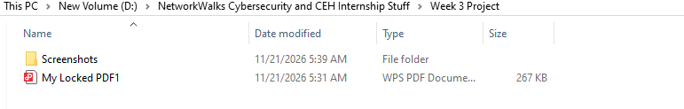

**02. John the Ripper Downloaded**

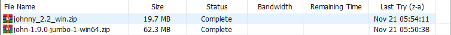

**03. Johnny Installed**

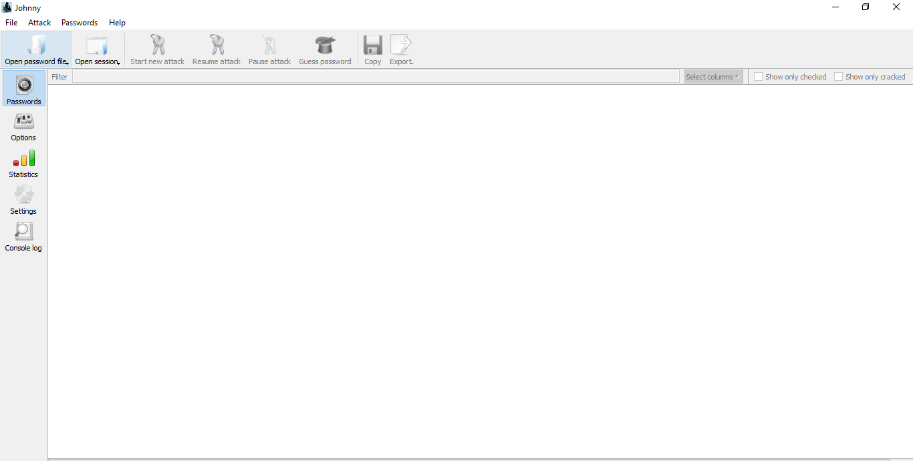

**04. John Executable Located**

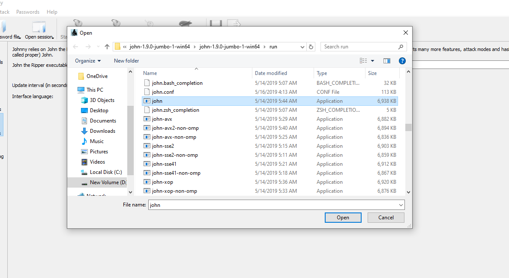

**05. Johnny Configuration**

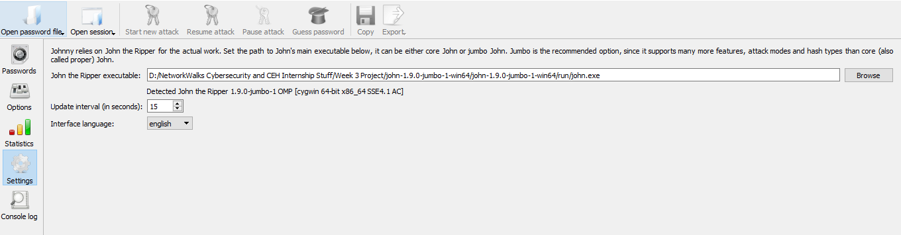

### Hash Extraction and JTR Attack

**06. PDF Hash Extraction**

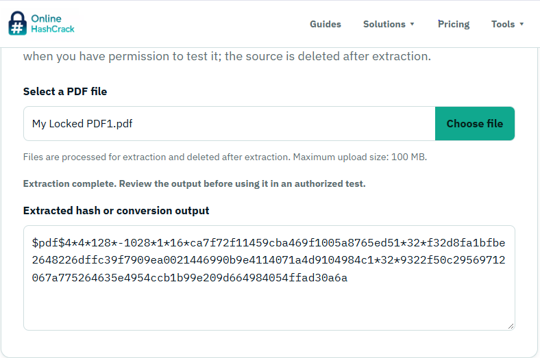

**07. Hash File Created**

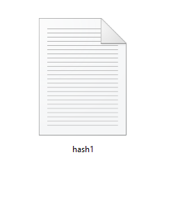

**08. Johnny Attack Result**

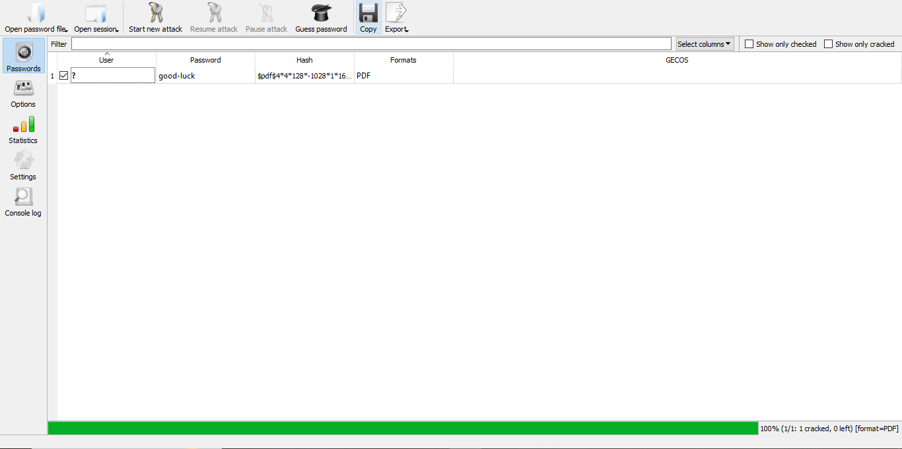

**09. PDF Successfully Unlocked**

### Networkwalks Tools

**10. Networkwalks Hash Calculator**

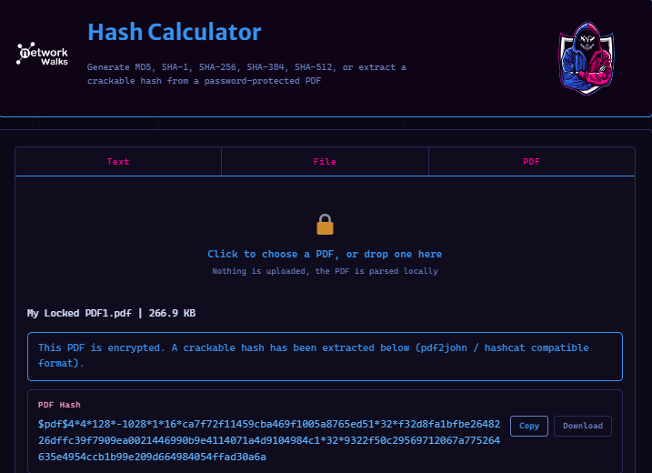

**11. Networkwalks Password Cracker**

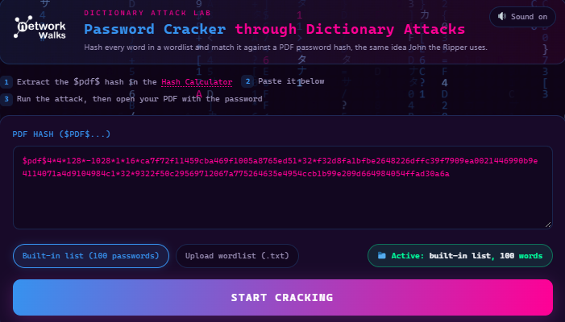

**12. Password Recovery Result**

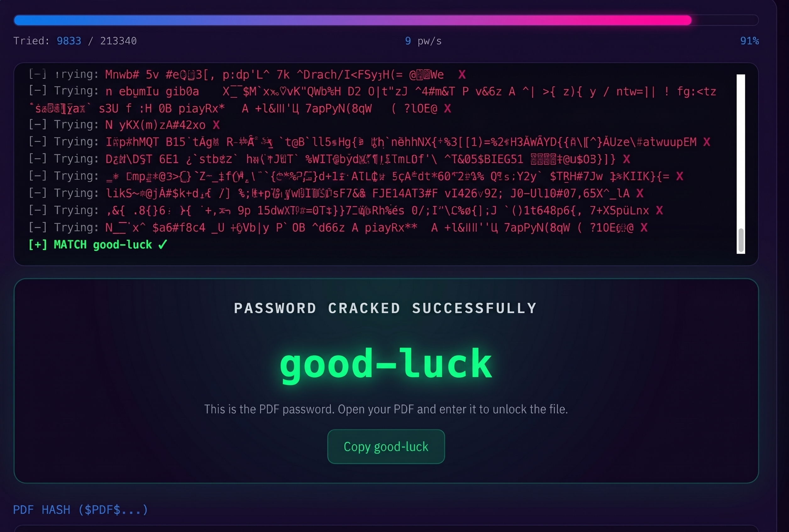

## Problems Faced and Solutions

No specific technical problem has been documented in the information collected for this report.

Both password recovery methods completed successfully.

## What I Learned

Through this week's practical work, I learned:

- How PDF password hashes are extracted.
- How John the Ripper processes password hashes.
- How to configure and use Johnny GUI.
- How to use online password recovery tools.
- How to compare two different password recovery approaches.
- Why strong passwords are important for protecting files and sensitive information.
- Why practical password security testing must stay within authorized environments.

## Conclusion

Week 3 provided practical experience with two PDF password recovery approaches.

Both John the Ripper and Networkwalks' online tools successfully recovered the same password from the provided test PDF.

This exercise improved my understanding of password security, hash extraction, and password recovery techniques.

## Author Information

**Arban Iqbal Khan**
Cybersecurity Intern, Networkwalks
Batch: B084

- GitHub: [https://github.com/arbaniqbalk](https://github.com/arbaniqbalk)
- LinkedIn: [https://www.linkedin.com/arbaniqbalk/](https://www.linkedin.com/arbaniqbalk/)

**Internship:** Networkwalks Cybersecurity Internship
**Week:** 03
**Project:** Password Cracking with JTR and Networkwalks Tools

---

*This project was performed for educational purposes using the PDF supplied by Networkwalks as part of its authorized internship lab.*
